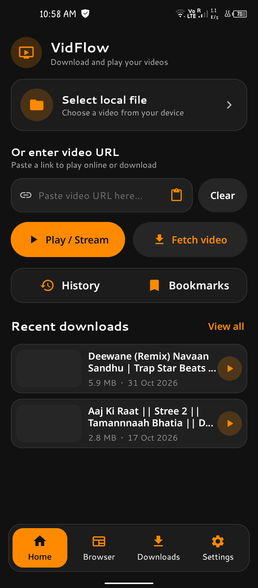
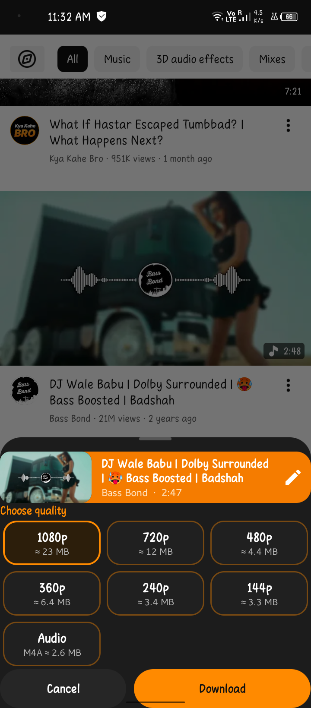
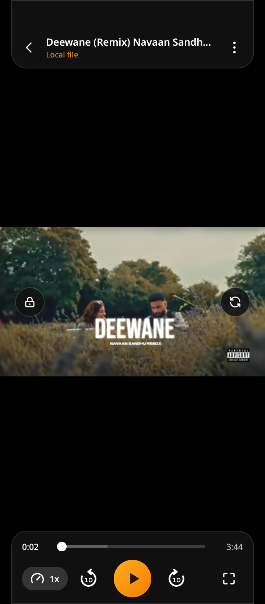
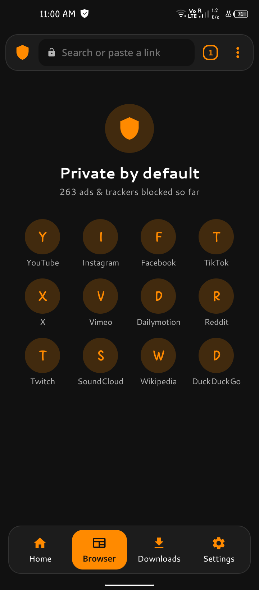
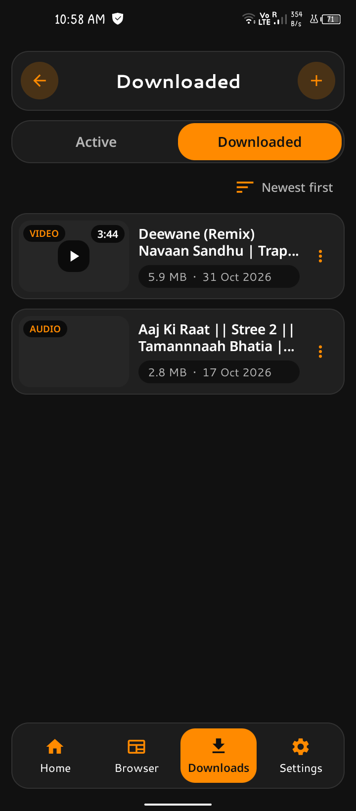
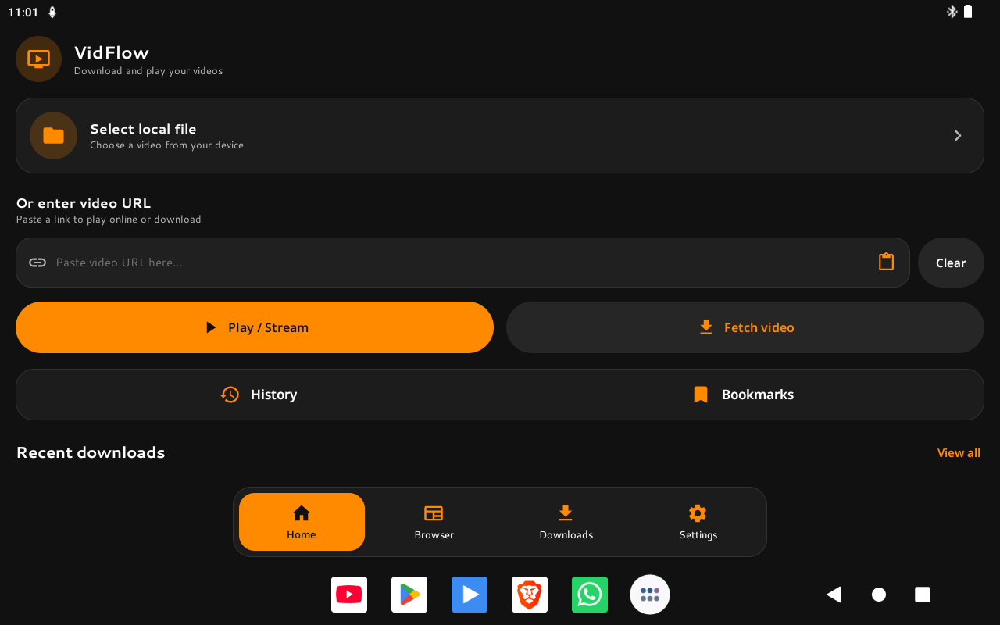
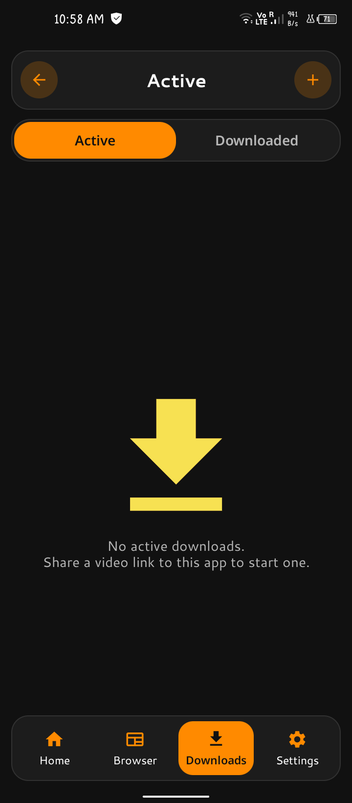

<div align="center">

# VidFlow

**Download, play and browse videos privately, all in one Android app.**


</div>

---

## Overview

**VidFlow** is a video downloader, media player and privacy-focused browser for Android. Paste a link, pick a quality and download it, or stream it straight into the built-in player. Several extraction engines work together behind one screen, so most links play or download without any extra steps.

The whole app is written in **Java** and built on a phone with the **CodeAssist** IDE.

- Package name: `com.nextgen`
- Minimum Android version: 10 (API 29)
- Target SDK: 36

## Screenshots

| Home | Download popup | Player |
|:---:|:---:|:---:|
|  |  |  |

| Browser | Downloads | Tablet / landscape |
|:---:|:---:|:---:|
|  |  |  |

| Download |
|:---:|
|  |

## Features

### Downloader
- Paste a link (or share it from any app) and get a quality list with file sizes.
- Video and audio-only downloads.
- Runs as a foreground service with a progress notification.
- Two engines with automatic fallback: **yt-dlp** and **NewPipe Extractor**.
- Download history and a built-in Downloads tab.

### Player
- Custom player screen with a themed, floating control layout.
- Play from a link, a downloaded file or any video or audio file on the device.
- Quality, audio track, subtitle and playback speed menus.
- Brightness and volume sliders, pinch to zoom and pan, screen lock and rotate.
- Video draws all the way to the notch.
- Repeat, sleep timer and resume from the last position.
- Appears in the system **Play with** list for video and audio files.

### Smart play engine
Every pasted link goes through a ladder of engines until ExoPlayer gets a stream it can play:

| Link type | Order of engines |
|---|---|
| YouTube | NewPipe, yt-dlp, yt-dlp with other clients |
| Other sites | Direct media check, yt-dlp, NewPipe, page source scan |

If playback fails, the next engine is tried automatically. If everything fails, the error screen lists the reason from each engine.

### Background play
- Behaves like a music player: playback continues when you leave the app.
- Media notification with play/pause, seek buttons, repeat, close and progress.
- Tapping the notification, or reopening the app, returns to the same playing session.
- Can be switched off from the player's **More** menu.

### Privacy browser
- Tabbed in-app browser.
- Ad, tracker and pop-up blocking.
- Protection against forced redirects and hidden click-jacking.
- Detects videos on a page and plays or downloads them.

### Share and integration
- **VidFlow Download**: share a link to open the download popup.
- **VidFlow Play**: share a link or a media file to play it right away.
- Works as a video player for files opened from file managers.

### Interface
- Dark, custom-themed UI with themed dialogs and toasts.
- Responsive layouts for phones, tablets and landscape.
- Multiple app languages.

## Tech Stack

| Area | Library |
|---|---|
| Language | Java |
| Playback | ExoPlayer 2.19.1 |
| YouTube extraction | NewPipe Extractor |
| Site extraction and downloads | yt-dlp via youtubedl-android (with FFmpeg and aria2c) |
| Networking | OkHttp, Retrofit |
| HTML parsing | jsoup |
| Images | Glide |
| Animation | Lottie |
| UI | AppCompat, Material Components, ViewBinding |

## Project Structure

```
app/src/main/java
├── coreUtils/        Base classes, helpers and shared views
├── dataRepo/         App settings and data storage
├── sysModules/
│   ├── browserEngine/    Tabs, ad blocking, redirect protection
│   ├── downloadSys/      Download service, yt-dlp and NewPipe engines
│   ├── mediaEngine/      Direct link check and page scanner
│   ├── sysPlayer/        Playback service, notification, media session
│   ├── newPipeLib/       NewPipe integration
│   └── crashedHandler/   Crash and hang logging
└── userInterface/
    ├── mainScreen/       Main activity and tabs
    ├── fragmentsUIs/     Home, Browser, Downloads, Settings
    ├── watchVideo/       Player screen
    └── intentHandler/    Share and Play with handlers
```

## Build

This project is built with **CodeAssist** (no Gradle, no annotation processors).

1. Create a new project in CodeAssist:
   - Name: `VidFlow`
   - Package: `com.nextgen`
   - Language: Java
   - Min SDK: 29
   - Target SDK: 36
2. Replace the generated `app` folder with the `app` folder from this repository.
3. Add the **JitPack** repository (`https://jitpack.io`) in the project settings. NewPipe Extractor and StyledCardView are served from there.
4. Sync the dependencies listed in `app/module.toml`.
5. Build and install.

If a build fails with a dexing or zip error, delete the CodeAssist `resolved-deps` and `resolved-deps-misses` cache folders and sync again.

## Permissions

| Permission | Why |
|---|---|
| Internet, network state | Streaming and downloading |
| Notifications | Download progress and media controls |
| Foreground service (data sync, media playback) | Downloads and background play |
| Wake lock | Keeps playback running with the screen off |
| Storage access | Saving downloads and reading local media |

## Roadmap

- [ ] Playlist and batch downloads
- [ ] Download queue controls
- [ ] More built-in player gestures
- [ ] Picture-in-picture

## Disclaimer

VidFlow is meant for personal use with content you own or have the right to save. Respect copyright and the terms of service of the sites you use. The developer is not responsible for how this app is used.

## Acknowledgements

- [yt-dlp](https://github.com/yt-dlp/yt-dlp) and [youtubedl-android](https://github.com/yausername/youtubedl-android)
- [NewPipe Extractor](https://github.com/TeamNewPipe/NewPipeExtractor)
- [ExoPlayer](https://github.com/google/ExoPlayer)
- [Glide](https://github.com/bumptech/glide), [Lottie](https://github.com/airbnb/lottie-android), [jsoup](https://jsoup.org/)

## License

Add a license file (for example MIT) and describe it here.

## Contact

Built by an independent Android developer. Open an issue in this repository for bugs and feature requests.
